<div align="center">

# 🏛️ POLYDIM-THEORICAL
### *Mathematical Foundations Vault, Riemannian Geometry & 1,736 Certified Formal Theorems*

[](https://doi.org/10.5281/zenodo.21136742)
[](https://hal.science/hal-05847496v1)
[](https://huggingface.co/datasets/Polydim-Einsof/POLYDIM-EINSOF-Canonical-Papers-V1550)
[](https://github.com/AGT1973/POLYDIM_EinSof)

[](BOVEDA_TEOREMAS_1607_COMPLETA.md)
[](https://lean-lang.org/)
[](https://opensource.org/licenses/Apache-2.0)
[](https://orcid.org/0009-0001-2787-6067)
[](https://discuss.ai.google.dev/t/polydim-einsofos-breaking-the-1d-token-bottleneck-via-continuous-stiefel-manifold-geometry/197762)

**Riemannian Manifolds • Stiefel Geodesics • Clifford & Lie Algebras • Shannon DPI Elimination • Quantum Intra-Chip Verification**

[📐 Theoretical Framework](#-core-mathematical-framework) • [🏛️ Theorem Taxonomy](#-the-1736-certified-theorems-vault) • [📂 Repository Layout](#-repository-structure) • [📜 Manuscripts](#-canonical-manuscripts) • [📖 Citation](#-bibtex-citation)

</div>

---

## 🧭 Overview & Mission

**POLYDIM-THEORICAL** is the formal mathematical and analytical vault of the [POLYDIM / EinsofOS](https://github.com/AGT1973/POLYDIM_EinSof) research program.

While the primary repository (`POLYDIM_EinSof`) delivers the physical silicon kernels (C++20, Rust, AVX2, Triton) and zero-copy shared memory buses (`PMTP`), this repository contains the **mathematical spine**:
- **1,736 formally certified theorems** tracked with cryptographic hashes in PostgreSQL 16.
- Formal proofs in **Lean 4**.
- Riemannian geometry on the **Stiefel manifold $\mathrm{St}(k, n)$** and unit hypersphere $\mathbb{S}^{D-1}$.
- Clifford Geometric Algebra $\mathcal{C}\ell(p, q)$ and $\mathfrak{so}(n)$ Lie algebra projections.
- Hardware-grounded verification results from **IBM Quantum QPU silicon** (`silicio_real_ibm_kingston_multiproblema.json`).

---

## 📐 Core Mathematical Framework

```mermaid
flowchart TD
    subgraph S1["1. Information Theory & Shannon DPI"]
        A["Irreversible 1D Collapse: H(X) << H(S)"] -->|"Dimensional Preservation"| B["Continuous Embedding in R^D (D >= 4096)"]
    end

    subgraph S2["2. Riemannian Geometry on Stiefel Manifold"]
        B --> C["Compact Stiefel Manifold: St(k, n) = {X | X^T X = I_k}"]
        C --> D["Geodesic Transport: Exp_X(Delta) on Tangent Space"]
    end

    subgraph S3["3. Geometric & Lie Algebras"]
        D --> E["Clifford Algebra Cl(p, q) & Rotor Operators"]
        E --> F["so(n) Lie Algebra Infinitesimal Generators"]
    end

    subgraph S4["4. Numerical Precision & Silico Invariance"]
        F --> G["Riemannian Polar QR Retraction"]
        G --> H["Compensated Neumaier Accumulator (Drift <= 10^-15)"]
    end

    subgraph S5["5. Formal & Physical Certification"]
        H --> I["PostgreSQL 16 Certified Vault (1,736 Theorems)"]
        H --> J["Lean 4 Formal Proofs + IBM Quantum QPU Verification"]
    end

    style S1 fill:#1c1e24,stroke:#e74c3c,stroke-width:1px;
    style S2 fill:#1c1e24,stroke:#3498db,stroke-width:1px;
    style S3 fill:#1c1e24,stroke:#9b59b6,stroke-width:1px;
    style S4 fill:#1c1e24,stroke:#2ecc71,stroke-width:1px;
    style S5 fill:#1c1e24,stroke:#f1c40f,stroke-width:1px;
```



### 1. The Stiefel Manifold Invariant $\mathrm{St}(k, n)$
Hidden state projections between multi-agent cognitive layers satisfy exact orthonormality:

$$\mathrm{St}(k, n) = \left\{ X \in \mathbb{R}^{n \times k} : X^T X = I_k \right\}$$

This condition guarantees:
* **Strict Isometry & Energy Conservation:** $\|X v\|_2 = \|v\|_2 \quad \forall v \in \mathbb{R}^k$
* **Semantic Angle Invariance:** Inner products $\langle X u, X v \rangle = \langle u, v \rangle$ remain undisturbed across multi-hop agent chains.
* **Neumaier Machine-Precision Bound:** Relative norm error remains bounded by $\le 10^{-15}$.

### 2. Elimination of Shannon's DPI Collapse
Traditional LLM agent pipelines serialize high-dimensional representations into 1D strings, triggering the Data Processing Inequality (DPI):

$$I(S; Y) \le I(S; X)$$

By transmitting continuous manifold representations via zero-copy physical memory slabs, POLYDIM preserves mutual information:

$$I(S; \mathrm{SLAB}) = I(S; h), \quad \Delta_{\mathrm{DPI}} = 0$$

---

## 🏛️ The 1,736 Certified Theorems Vault

All mathematical statements are cataloged in `boveda_teoremas_1607.json` and rendered in the [Complete Theorem Vault](BOVEDA_TEOREMAS_1607_COMPLETA.md):

| Domain / Section | Certified Statements | Key Topics & Mathematical Focus |
|:---|:---:|:---|
| **Section 1: Geometric & Clifford Algebra** | 342 Theorems | $\mathcal{C}\ell(p, q)$ bivectors, sandwich products $R x \tilde{R}$, spinorial rotations, metric signature invariance. |
| **Section 2: Stiefel Manifolds & Geodesics** | 418 Theorems | Retraction mappings $\mathcal{R}_X(\xi)$, polar decomposition stability, tangent space horizontal/vertical splitting. |
| **Section 3: Information Theory & DPI** | 289 Theorems | Shannon entropy conservation, manifold mutual information, channel capacity bounds under zero-token transport. |
| **Section 4: Multi-Hop Stability & Asymptotics** | 385 Theorems | Lyapunov stability for multi-agent chains, contraction mappings, Neumaier accumulation error bounds under finite precision. |
| **Section 5: Silicon & Quantum Grounding** | 302 Theorems | Physical QPU reduction (IBM Kingston QPU, 127 qubits), AVX-512 Neumaier SIMD kernels, POSIX `/dev/shm` barrier safety. |

👉 **Interactive Browser:** Open [`catalogo_teoremas_interactivo.html`](catalogo_teoremas_interactivo.html) in your browser for dynamic searching, filtering, and cross-referencing across all 1,736 proofs.

---

## 📂 Repository Structure

```text
POLYDIM-THEORICAL/
├── PAPER/                          # LaTeX sources & camera-ready manuscripts
│   ├── DIMENSION_IS_ALL_YOU_NEED_PAPER_V1550.tex
│   └── DIMENSION_IS_ALL_YOU_NEED_PAPER_V1550_HARDENED.pdf
├── PRESENTACIONES/                 # Executive slide decks (.pptx)
├── CONSTITUCION_TESIS_MANIFESTO/   # Doctoral thesis framework & manifesto
├── WHITEBOOK/                      # EinsofOS Enterprise Whitebook specifications
├── SOTA/                           # Comparative literature & Red Team audits
├── verification_suite/             # PostgreSQL 16 certification test harnesses
├── boveda_teoremas_1607.json       # Machine-readable JSON theorem database
├── BOVEDA_TEOREMAS_1607_COMPLETA.md# Comprehensive Markdown theorem reference
└── catalogo_teoremas_interactivo.html # Standalone interactive theorem explorer
```

---

## 📜 Certified Preprints & Permanent Identifiers

| Archive / Registry | Identifier / Code | Canonical Link |
|:---|:---|:---|
| **CERN / Zenodo (Primary DOI)** | `10.5281/zenodo.21136742` | [https://doi.org/10.5281/zenodo.21136742](https://doi.org/10.5281/zenodo.21136742) |
| **CERN / Zenodo (Secondary DOI)** | `10.5281/zenodo.21209973` | [https://doi.org/10.5281/zenodo.21209973](https://doi.org/10.5281/zenodo.21209973) |
| **CNRS / HAL Open Science (France)** | `hal-05847496v1` | [https://hal.science/hal-05847496v1](https://hal.science/hal-05847496v1) |
| **Center for Open Science (OSF)** | `osf.io/za3s7` | [https://osf.io/za3s7](https://osf.io/za3s7) |
| **JST / Jxiv (Japan)** | `Jxiv ID 7040` | [https://jxiv.jst.go.jp](https://jxiv.jst.go.jp/index.php/jxiv/authorDashboard/submission/7040) |
| **INRIA / UNESCO Software Heritage** | `swh:1:snp:bdea78b3...` | [Software Heritage Snapshot](https://archive.softwareheritage.org/swh:1:snp:bdea78b37132a4bd6b67049805cbb6d4472ec2cd) |
| **ORCID Verified Researcher Record** | `0009-0001-2787-6067` | [https://orcid.org/0009-0001-2787-6067](https://orcid.org/0009-0001-2787-6067) |

---

## 📖 BibTeX Citation

```bibtex
@article{garcia_traba_2026_polydim_theory,
  author    = {Garc{\'i}a Traba, Ariel H.},
  title     = {POLYDIM-EINSOF: Zero-Token Inter-Model Latent Transfer via Stiefel Manifolds and the PMTP Protocol},
  journal   = {EinsofOS Sovereign Research},
  year      = {2026},
  month     = {nov},
  publisher = {Zenodo / CERN & HAL Open Science},
  doi       = {10.5281/zenodo.21136742},
  url       = {https://doi.org/10.5281/zenodo.21136742},
  note      = {Theory Vault: https://github.com/AGT1973/POLYDIM-THEORICAL | Codebase: https://github.com/AGT1973/POLYDIM_EinSof}
}
```

---

<div align="center">

**Developed by Ariel H. García Traba**  
*Buenos Aires, Argentina • EinsofOS Independent Research*  
*Mathematical Vault Certified under Apache License 2.0*

</div>
